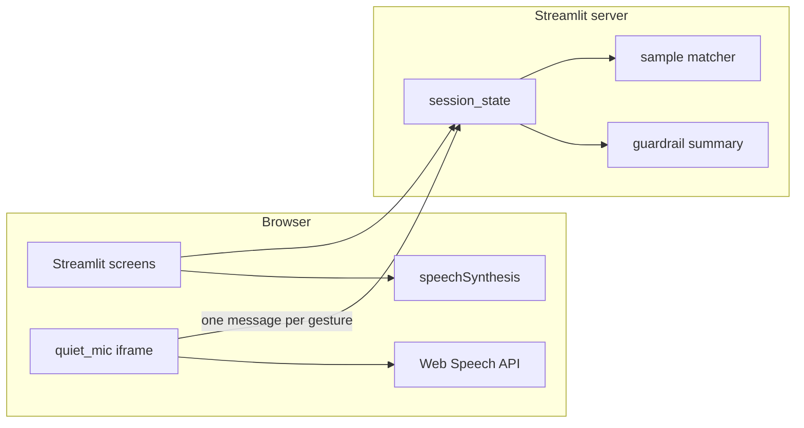

# Architecture

Quiet Voice Mode is a single Streamlit process. The browser does the speech work. The Python process owns the screen, the sample answers, and the event log. There is no database and no model API.

## Why the mic is an iframe

Streamlit reruns the Python script on every widget change. A press-and-hold gesture cannot survive that rerun if the button lives in Python. The hold, the slide-to-cancel, the live-versus-hidden transcript, and the beep-versus-buzz contrast stay inside `components/quiet_mic/index.html`. The iframe posts one JSON value when the gesture ends. Python reruns then, and only then.

The iframe is allowed to use the microphone by Streamlit’s component permissions. Real speech still depends on a Chromium browser that exposes `webkitSpeechRecognition`. Demo speech never calls it.

A second `getUserMedia` stream is intentionally not opened. On Chrome it competes with the recognizer and can return an empty transcript. Noise and earphone state come from the gear instead.

## Modules

| Path | Responsibility |
| --- | --- |
| `app.py` | Screens, gear, session state, when events are written |
| `components/quiet_mic/index.html` | Hold / tap gesture, Web Speech, demo mishear playback |
| `quiet_voice/catalog.py` | Languages, beta copy, fixed questions and answers |
| `quiet_voice/match.py` | Shared matcher used by Version A and Version B |
| `quiet_voice/speech.py` | Demo mishear, n-best alignment, noise bucket, public-setting flag |
| `quiet_voice/events.py` | Allowed event names and the event shape |
| `quiet_voice/metrics.py` | Session guardrail math for the gear |
| `docs/` | PRD, this architecture, the implementation notes, and the software list |

## Session state

One Streamlit session is one participant. Refreshing the tab starts over. Reset does the same.

Important keys:

- `version` — `A` or `B`
- `language_choice` — `unset` or a language code
- `screen` — `chat`, `language`, `listen`, or `review`
- `messages` — the thread, including fixed answers
- `review` — words, alternatives, and latency for the open review
- `events` — the append-only log
- `speech_mode` — `Real` or `Demo`. The session opens on Real. Demo replays a sample and does not open the microphone.
- `noisy`, `earphones`, `hide_default` — measurement and privacy switches
- `streak`, `streak_date` — Version B reinforcement, local to the session

Widget-backed keys are changed from button callbacks, which Streamlit runs before the next script pass. That avoids writing a widget value after the widget has already been drawn.

## Arms

Both arms call `match_answer`. Version B must pass through review before `send_tapped` with `channel=voice`. Version A puts the transcript in the composer and waits for Send. The win banner, the streak, and the comfort check run only in Version B, so the control arm does not receive the reinforcement it is supposed to lack.

## Screens

| Screen | What it shows |
| --- | --- |
| `chat` | The thread, the Version B prompt, and the composer. Under the composer, two suggestions: the first Hindi question and the first Hinglish question. |
| `language` | Language picker, only when none has been chosen yet. |
| `listen` | The hold or tap control. No suggestion list. |
| `review` | Version B only. The transcript, word fixes, and the current language’s samples. |

`render_few_suggestions` draws those two buttons and is called only after the message bar. Tapping one returns that fixed answer and logs `sample_question_picked`.

## Matching

Both arms call `match_answer`. It searches the active language first, then Hindi and Hinglish, then English. The two buttons under the composer are only a hint. Every sample can still match.

The score uses four signals:

- `SequenceMatcher` against the question text. A ratio with no shared words is discounted, so a short unrelated line does not win by accident.
- Overlap of content words, ignoring fillers such as “mein”, “kya”, and “को”.
- Keyword hits. Two hits match. One long keyword, such as “photosynthesis”, can match on its own. A keyword may differ by a small spelling change, such as “byaj” and “byaaj”.
- A nearest-question rule. If the best score is at least 0.34 and clearly ahead of the next sample, that answer is returned even when it is under the 0.42 threshold.

An unrelated line still gets the sample list for the active language, not a generated answer. “aloo pyaaz se kya bana sakte hain” answers the potato question. “hello how are you” does not.

## Measurement

`public_setting_flag` is true only when the bucket is `moderate` or `loud` and earphones are out. “Noisy place” forces the bucket to `loud`, which is how a desk test can still produce a public-setting event. This flag never changes the screen. It only changes the log.

## Failure behavior

| Failure | What the person sees |
| --- | --- |
| Browser has no Web Speech | The whisper screen says so. Demo speech still completes the flow. |
| Hold was under half a second | “Hold a little longer.” Nothing is logged as a send. |
| Slide up or Escape | Cancel event. The whisper screen stays up. |
| Empty real transcript | A plain error, no review, no send. |
| Question only near a suggestion | That suggestion’s fixed answer. |
| Question outside the sample set | The list of sample questions for the active language. |
| Recognizer returns one hypothesis | Review still opens. Edit-all is the fix path. |

## What this is not

This is not the ChatGPT client. It does not call an OpenAI API, does not train a model, and does not detect a real room. Haptics vibrate only on phones that allow `navigator.vibrate`. Desktop buzz is a no-op, which the chip still explains.
